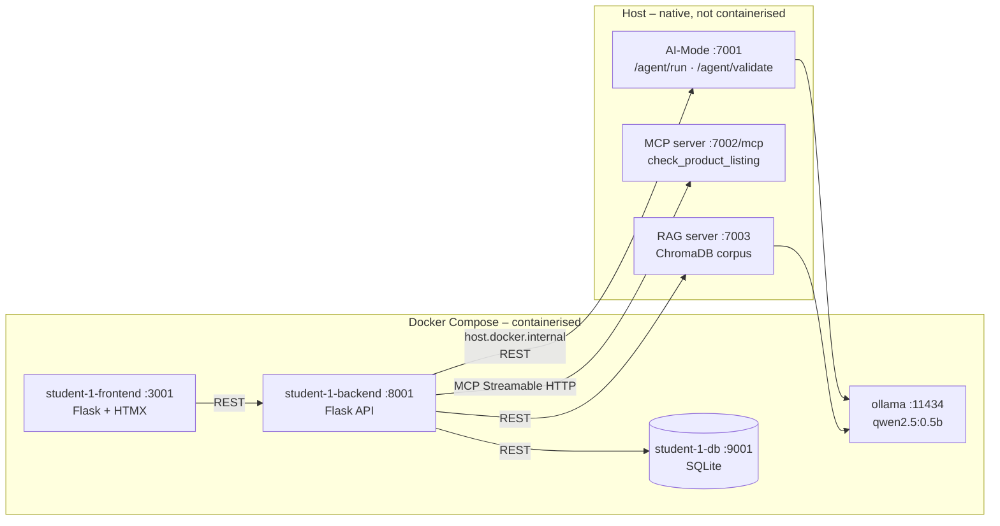
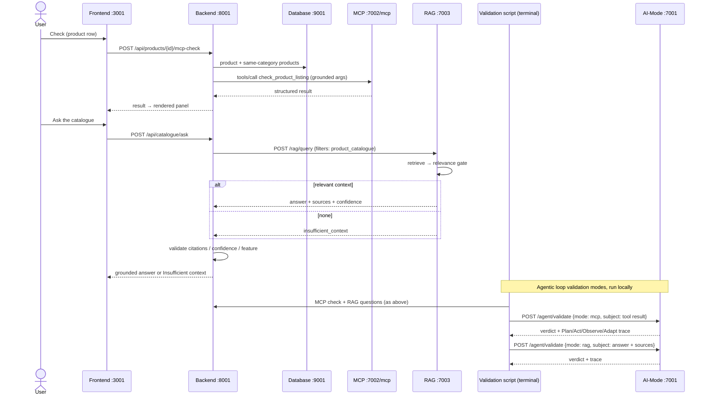

# Release 1 – Student 1 (Ronaldo Kwan) – Product Catalogue

Drop-in content for the group technical report (`group-40.pdf`). Evidence files are in
`docs/evidence/student-1/` and were produced by `student-1/validation/validate_release1.py`.

## 1. Scope and responsibilities

**Release 0 baseline.** Product Catalogue: containerised frontend (Flask + HTMX, :3001),
backend/API (Flask, :8001) and database (SQLite behind a data API, :9001). It provides full CRUD,
category filtering, SKU generation and an AI-Mode copy assistant (Plan → Act → Observe → Adapt).

**Release 1 – individual (Student 1).**

| Area | Work |
|---|---|
| MCP | Designed and registered `check_product_listing` on the shared MCP server; backend MCP client grounded from the database; contract validation; **Check** action on every product row |
| RAG | `product-catalogue-policy.md` knowledge source; live product records synced into the shared corpus on create/update/delete; feature-scoped queries; answer/citation validation; **Ask the catalogue** panel |
| Agentic loop | Validation script runs the shared loop's MCP and RAG validation modes on real Product Catalogue results |
| DevOps | `student-1.yml` with AI-Mode/MCP/RAG disabled; Compose wiring for host services |
| Shared fixes | RAG `rag-feature` knowledge tagging, full-chunk `text` in sources, stale-knowledge pruning; Windows support in `run-ai-services.sh` |

**Shared (group).** The MCP server, RAG pipeline, `/agent/validate` modes and Compose
de-containerisation were built on Student 3's `release-1-mcp-rag` branch. Student 1's changes to
shared code are additive and covered by the shared test suites.

## 2. Functional requirements (Student 1)

| ID | Requirement |
|---|---|
| FR1-1 | From the catalogue UI, a user can run the shared MCP tool `check_product_listing` on any product, through the backend/API |
| FR1-2 | The backend grounds the tool with the other products in the same category (count, average, minimum, maximum price) |
| FR1-3 | The UI displays the structured result: listing status, price position, % versus average, issues, warnings and errors |
| FR1-4 | A user can ask a natural-language catalogue question; the backend queries the shared RAG server scoped to `product_catalogue` |
| FR1-5 | A grounded answer shows the source citations and a confidence category (high / medium / low) |
| FR1-6 | When no relevant context exists, the UI shows an *Insufficient context* state and no answer |
| FR1-7 | Product create, update and delete keep the RAG corpus in step; `POST /api/catalogue/rag-sync` rebuilds it |
| FR1-8 | The shared agentic loop validates a Product Catalogue MCP result and RAG answer in its MCP and RAG modes (run locally from the terminal) |
| FR1-9 | All Release 0 functionality (CRUD, filters, AI-Mode copy) keeps working |

## 3. Non-functional requirements (Student 1)

| Quality | Requirement (measurable) | How it is met |
|---|---|---|
| Security / tool boundary | The MCP tool has no database address, credential or write path; out-of-schema arguments are rejected | Pure function; MCP schema validation (test + evidence `02`) |
| Grounding | 100% of displayed answers have ≥1 citation from `product_catalogue`; foreign sources are rejected (HTTP 502) | `rag_client._validate_sources`; 5 rejection tests |
| Traceability | Every RAG answer cites source + section; every query is audited by the RAG server | `data/rag-audit.jsonl`; evidence `09`–`11` |
| Reliability | MCP/RAG/AI-Mode outages never break CRUD; catalogue writes still succeed when RAG is down | best-effort sync (3 s connect / 15 s read); test `test_rag_outage_never_blocks_a_catalogue_write` |
| Performance | MCP check < 1 s; health probes fail fast (≤ 3 s) so the 5 s Docker healthcheck holds | measured 58 ms MCP round trip; RAG answer ≈ 1–3 s on `qwen2.5:0.5b` |
| Usability | Results show beside the action; errors explain how to start the shared services | `show:#mcp-card:top`; `run-ai-services.sh` hint |
| Maintainability | MCP and RAG each sit behind one backend module with typed exceptions | 112 tests (76 from Release 0, 36 new) |
| Interoperability | Genuine MCP Streamable HTTP via the official `mcp` SDK; RAG over REST/JSON | `mcp_client.py` |
| Availability | Each integration can be switched off (`*_ENABLED`) without code changes | CI runs with all three disabled |

## 4. Architecture (Student 1 slice)

## 5. MCP and RAG design

**Registered tool `check_product_listing`.** It is read-only and deterministic.

* **Inputs:** `sku`, `name`, `category`, `price`, `status`, plus optional `description`,
  `comparable_count/avg/min/max_price`.
* **Outputs:** `listing_status` (ready / needs_attention / invalid), `price_position`
  (below / within / above range, no_comparables, unknown), `price_vs_average_pct`,
  `comparable_count`, `description_word_count`, `issues[]`, `warnings[]`, `errors[]`.
* **Contract:** `ai-services/mcp-server/tool-contracts.md`.

**Knowledge sources** (both tagged `feature: product_catalogue`):

* `product-catalogue-policy.md`: 7 sections, each ≤ 200 characters.
* Live product records: one document per product, `catalogue:product:<id>`.

**Confidence** comes from the number of supporting chunks (3+ high, 1–2 medium), not from the model.

## 6. Validation and results

| # | Check (evidence file) | Result |
|---|---|---|
| Terminal | MCP `tools/list` includes `check_product_listing`; `tools/call` returns `ready / within_range`; an out-of-contract call is rejected (`01`, `02`) | PASS |
| Terminal | RAG direct: price question → *Pricing Rules*, confidence medium; off-topic → `insufficient_context` (`04`, `05`) | PASS |
| Backend | `/health` shows DB, AI-Mode, MCP and RAG all ok (`06`); 15 products indexed (`07`) | PASS |
| Backend | MCP check for SKU-AUD-1001: ready, within range, +104.4% vs average (`08`) | PASS |
| Agentic loop – MCP mode | `valid=true`, confidence high, 1 attempt, no fallback (`19`) | PASS |
| Backend | RAG product answer cites *SKU-AUD-1001 Aurora Wireless Headphones*; policy answer cites *Pricing Rules* (`09`, `10`) | PASS |
| Agentic loop – RAG mode | `grounded=true`, `unsupported_claims=none`, `confidence_ok=true` for both answers (`20`, `21`) | PASS |
| Backend | Off-topic question → no answer, no sources (`11`) | PASS |
| Frontend | MCP panel, grounded answer with citations + confidence badge, insufficient-context state (`12`–`14`) | PASS |
| Release 0 | 15 products listed; CRUD create → update → delete; AI-Mode copy suggestion, 1 attempt, no fallback (`15`, `16`) | PASS |
| Compose | 17 containers up; no `ai-mode`, `mcp` or `rag` service (`17`) | PASS |
| CI replay | Backend with `*_ENABLED=false`: health reports disabled, MCP/RAG return 503 "integration is disabled", AI copy uses fallback (`18`) | PASS |

Overall: **23/23** live checks (`00-summary.json`, `validation-run.log`). Unit tests: Student 1
112, AI-Mode 18, MCP server 22, RAG server 52, all passing.

**Issues found and fixed by live validation:**

1. The price-range question retrieved *Product Status* because that section repeated "product".
   The policy was reworded, and nine questions are now pinned to their expected source in tests.
2. RAG-mode validation judged a correctly grounded long answer "not grounded", because it only saw
   the 200-character snippet. Sources now carry the full retrieved chunk as `text`.

**GitHub Actions:** `student-1.yml` run link — *add after push*.

## 7. Individual contribution log – Student 1 (Ronaldo Kwan)

| Date | Commit | Work |
|---|---|---|
| 2026-10-01 | `13e2611` | feat(mcp): `check_product_listing` tool, MCP registration, contract, tool + protocol tests |
| 2026-10-01 | `84f9420` | feat(rag): catalogue knowledge source, `rag-feature` tagging, RAG tests |
| 2026-10-01 | `34bee20` | feat(student-1): backend MCP/RAG clients, routes, frontend panels, 36 tests |
| 2026-10-01 | `a7d81d4` | ci(student-1): workflow with MCP/RAG disabled, Compose wiring, Windows launcher fix |
| 2026-10-01 | `f029ead` | fix(rag): correct section retrieval, full-chunk `text`, stale knowledge pruning |
| 2026-10-01 | `b77ac53` | fix(student-1): full-chunk validation subject, table layout |
| 2026-10-01 | *(this commit)* | docs(student-1): README, validation script, evidence, this report section |

## 8. Known issues and limitations

* AI-Mode, MCP and RAG must be started on the host (`bash scripts/run-ai-services.sh`) after
  `docker compose up`. Without them the catalogue still works, but the MCP/RAG panels show
  "unavailable".
* On Windows, stopping `run-ai-services.sh` can leave the Python processes running (including
  AI-Mode's Flask reloader child). Stop them in Task Manager before restarting.
* RAG retrieval uses keyword-hashing embeddings, not semantic ones. Synonyms that share no words
  with the source (for example "cost" versus "price") can return *insufficient context*.
* Deleting products by reseeding the database (`/admin/reseed`) bypasses the backend, so the
  extra records' RAG documents stay in the corpus until they are re-indexed or deleted.
* With `qwen2.5:0.5b` the model often paraphrases. The RAG server then falls back to extractive
  evidence, so answers can be verbatim record text rather than a concise sentence.
* RAG answers reflect the live records. Product #1's description was AI-edited in Release 0 testing,
  so it no longer mentions noise cancelling; `POST :9001/admin/reseed` restores the seed text.
