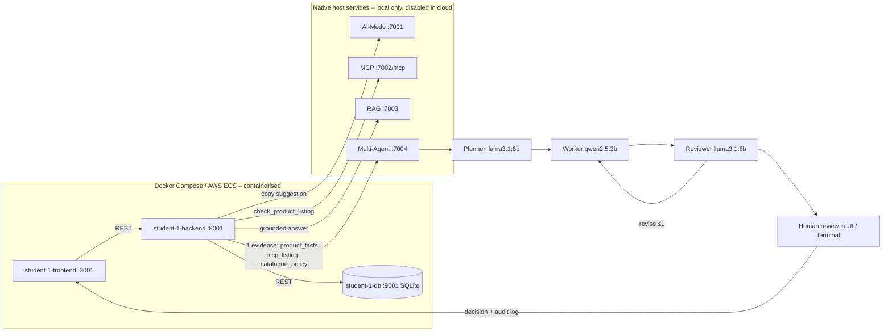

# Release 2 – Student 1 (Ronaldo Kwan) – Product Catalogue

Drop-in content for the group technical report (`group-40.pdf`). Evidence is in
`docs/evidence/student-1/release-2/`. The only item still marked **TO CAPTURE** is the AWS
deployment evidence, produced by the commands in §8 once the group deploys.

## 1. Release 2 contribution

| Area | Work |
|---|---|
| Multi-Agent integration | `multi_agent_client.py`: listing readiness review on the shared Multi-Agent server (7004). The backend supplies three evidence items – stored product fields with the application's deterministic check of each *Listing Readiness* rule, the MCP `check_product_listing` result (Reviewer cross-check) and the RAG policy – plus an application-enforced plan contract |
| Shared server robustness | Each role's rejected output is retried (3 attempts) with the rejection reason fed back; a Reviewer that stays self-contradictory is routed to Human Review flagged *unchecked* (all claims unsupported) instead of failing the workflow; Worker rationale limit raised from 300 to 600 characters so it is not cut mid-sentence |
| API | `POST /api/products/<id>/multi-agent`, `GET …/multi-agent/history`, `GET …/multi-agent/<workflow_id>`, `POST …/multi-agent/<workflow_id>/review` |
| Frontend UI | **Review** button on every product row; *Multi-Agent listing review* panel that polls Planner → Worker → Reviewer, then offers Accept / Partially accept (with corrections) / Reject; per-product workflow history |
| Terminal | `scripts/student-1-multi-agent.py start --product-id 1 --wait`, `review`, `history` |
| Post-commit CI/CD | `student-1/endpoint-tests/`: 10 live HTTP tests of **`create_product`** and **`update_product`**, run by `student-1.yml` against the started container |
| Pre-commit security | Ruff `S` rules extended to `student-1/`; `debug=True` removed from all three Student 1 services; shared S104/S201 findings in MCP/RAG fixed so the repository-wide scan passes |
| Agentic-loop evidence | `student-1/validation/release2_reviews.py` builds the Testing, Multi-Agent and Cloud Deployment review subjects from real evidence and saves the review + validation log |
| Cloud | Student 1 backend has `MULTI_AGENT_ENABLED=false` in Terraform; `validate-runtime.sh` now verifies Student 1 CRUD through the public frontend and that all four AI services report *disabled* |

## 2. Release 2 design flow (Student 1 slice)



Evidence status is explicit: if MCP or RAG is down the item is sent as `unavailable`, and if
the RAG answer does not cite *Listing Readiness* it is `insufficient`; the shared server then
forces the Reviewer to `not_supported`. The human decision is advisory – the product is only
changed through the catalogue form.

## 3. Pre-commit security testing

`.pre-commit-config.yaml` (shared) is installed as the git hook (`pre-commit install` →
`.git/hooks/pre-commit`), so it runs on every `git commit`; `student-1.yml` re-runs it on every
push. The log below is the hook run over all tracked files on 23 Oct 2026 (exit code 0).

| Hook | Scope | Result (`01-pre-commit-security-scans.log`) |
|---|---|---|
| Ruff security (`--select S`) | all Python in `student-1/`, `ai-services/`, `scripts/` | **Passed** |
| detect-secrets | every tracked file except `.env`, DBs, logs | **Passed** |
| pip-audit `--strict` | 16 requirement files | **Passed** (with 4 documented exceptions) |

Findings resolved: S201 `debug=True` in Student 1 backend, database and frontend and in the
MCP HTTP server; S104 binding to `0.0.0.0` accepted per file for the native MCP/RAG servers,
which must be reachable from containers via `host.docker.internal` (same rule the group applied
to AI-Mode). **Accepted risk:** `chromadb 1.5.9` has four advisories (PYSEC-2026-311, -3813,
-3814, -3815) with no fixed release; it backs only the local RAG server, which is not deployed in
the cloud baseline. They are ignored by ID, so any new advisory still fails the commit.

**Testing Review (agentic loop).** Run twice, so the review distinguishes local from hosted evidence:

| Input | Gate | Model (`llama3.1:8b`) | Authoritative | Evidence |
|---|---|---|---|---|
| Local hook log + local endpoint run, GitHub Actions *not run* | incomplete | incomplete | **incomplete** | `testing-review-local/` |
| `student-1.yml` run 39799057050 artifacts: CI hook log + post-commit endpoint JUnit, CI *passed* | passed | passed | **passed** | `testing-review-ci/` |

On the hosted evidence the gate records *"All three pre-commit security hooks and at least two
post-commit backend endpoint tests passed"*, and the model judged the test code well structured,
with meaningful assertions covering invalid payloads and duplicate SKUs.

## 4. Post-commit CI/CD endpoint testing (`student-1.yml`)

Pipeline: security scans → lint → 149 unit/integration tests → shared AI service tests → Docker
build → Compose up → **endpoint tests against the live container** → CRUD/frontend smoke →
AI services disabled check (incl. Multi-Agent 503).

| Endpoint function | Route | Tests | What is asserted |
|---|---|---|---|
| `create_product` | `POST /api/products` | 6 | 201 + normalised category/price/default status, persisted on re-read; SKU generated when omitted; 400 with details for bad category, out-of-range price, missing name; 409 duplicate SKU |
| `update_product` | `PUT /api/products/<id>` | 4 | partial update changes only supplied fields and persists; invalid price 400 and record unchanged; empty body 400; unknown id 404 |

**Hosted post-commit run:** commit `8241b55` pushed to `ronaldo`, workflow `student-1` run
[39799057050](https://github.com/ronaldokwan/ASD-2026-Project-Specifications/actions/runs/39799057050),
22 Oct 2026, **success** (both jobs). Artifacts in `ci-run-39799057050/`:

| Step in `student-1.yml` | Result |
|---|---|
| Security scans (Ruff, detect-secrets, pip-audit) | 3/3 Passed (`student-1-pre-commit.log`) |
| Student 1 microservice tests | 149 passed, 0 failed (`student-1-tests.xml`) |
| Shared AI-Mode / MCP / RAG / Multi-Agent tests | 29 / 30 / 60 / 33 passed, 0 failed |
| **Post-commit endpoint tests against the live container** | **10 passed** (`student-1-endpoint-tests.log/.xml`) |
| CRUD smoke, frontend smoke, AI services disabled (incl. Multi-Agent 503) | passed |

Also run locally against the Docker Compose containers before pushing: 10 passed in 1.3 s
(`03-endpoint-tests-local.log/.xml`).

## 5. Multi-Agent workflow evidence

**Defect found in live testing and fixed.** The first real runs all failed with *Reviewer
contradiction finding has no unsupported Worker claim*. Replaying the stages showed two causes:
the Worker (`qwen2.5:3b`) overran the 300-character rationale limit or miscounted words, and the
Reviewer (`deepseek-r1:8b`) caught the error but marked every claim *supported* in the same
answer, which the shared server rejected by failing the whole workflow. The fix moves the rule
arithmetic into the application (`readiness_checks`, `failed_checks`), keeps the MCP price
comparison out of the evidence, and makes the shared server retry and then escalate to the human
rather than discard a correct catch.

**Reviewer model evaluation.** Replaying the Reviewer on 3 correct and 2 deliberately wrong Worker
answers: `deepseek-r1:8b` produced valid output for 2 of 9 correct answers with the shared
instructions, and with simplified instructions it approved every answer including both wrong ones
(0/6 caught); enabling its reasoning mode made no difference because Ollama suppresses it under a
JSON schema. `llama3.1:8b` gave no wrong verdicts (passed correct answers, caught 3 of 4 wrong ones,
the rest rejected and retried), so it is now the default Reviewer. Because readiness is a
deterministic rule, the backend also adds an **application cross-check** comparing the Worker's
ready / not-ready verdict with `failed_checks`, shown beside the Reviewer at Human Review.

Verified without models: `test_multi_agent_contract.py` sends the Student 1 request to the real
shared server app (only Ollama stubbed) and asserts Planner → Worker → Reviewer → `human_review`,
the completion gate, the accept decision, history, and the audit sequence
`workflow_created … human_review_required … human_decision_recorded`; a second decision is 409
and a partial accept without corrections is 400.

**Live runs (real models, 23 Oct 2026).** Planner `llama3.1:8b`, Worker `qwen2.5:3b`, Reviewer
`llama3.1:8b`; each run took about 30 s. Evidence per run: `multi-agent-workflow.json` (full
workflow history), `coordination-audit-log.jsonl` (9 coordination events, from `workflow_created`
to `human_decision_recorded`), and the agentic-loop Multi-Agent Review with its validation log.

| Run | Product | Worker | Reviewer | Application cross-check | Human decision | Agentic-loop review |
|---|---|---|---|---|---|---|
| Terminal (`04-multi-agent-terminal-run.txt`, `multi-agent-terminal-run/`) | #2 Pebble Bluetooth Speaker (active) | ready ✅ | ready for human; claims supported | agrees | **accept** | supported |
| Frontend UI (`multi-agent-ui-run/`) | #7 Dual Port USB-C Charger (draft) | ready ❌ | ready for human; rationale unsupported | **disagrees: not ready, status not active** | **reject**, unresolved: set status to active | issues_found |

The UI run is the Human Review step working as intended: the Worker was wrong, the Reviewer only
partly flagged it, the application cross-check showed the failed rule, and the administrator
rejected the recommendation. The agentic-loop review of that run independently reported that the
Worker's verdict and the application check disagreed.

## 6. Local and cloud deployment

Local: Compose runs the three Student 1 containers with `MULTI_AGENT_URL=host.docker.internal:7004`;
`bash scripts/run-ai-services.sh` starts AI-Mode, MCP, RAG and Multi-Agent natively in one
terminal. Cloud (AWS ECS): Student 1 backend runs with AI-Mode, MCP, RAG and Multi-Agent all
`false`; `validate-runtime.sh` proves create → list → update → delete through port 3001 and that
`/health` reports all four as disabled. **TO CAPTURE:** `reports/aws-runtime-validation.json`.

## 7. Contribution log (Release 2)

| Date | Work |
|---|---|
| 22 Oct 2026 | Multi-Agent client, routes and error handling; UI panel, history and human review; terminal CLI |
| 22 Oct 2026 | 38 new tests (backend 21, frontend 14, shared-server contract 3); 10 post-commit endpoint tests; `student-1.yml` Release 2 pipeline |
| 22 Oct 2026 | Pre-commit coverage for Student 1; fixed shared Ruff findings; documented chromadb advisories |
| 22 Oct 2026 | Terraform/Compose Multi-Agent settings; Student 1 cloud runtime validation; review-mode evidence script |
| 23 Oct 2026 | Diagnosed live Reviewer failures; deterministic readiness checks and application cross-check; shared server retry and human-review escalation (3 new shared tests); Reviewer model evaluation and switch to llama3.1:8b |
| 23 Oct 2026 | Pre-commit hook installed; live endpoint tests; terminal and UI Multi-Agent runs with human decisions; AI-Mode review modes moved to `REVIEW_MODEL` (llama3.1:8b); Multi-Agent and Testing reviews generated |

## 8. Capturing the remaining evidence

```bash
# 1. Local multi-server run (terminal 1: Compose, terminal 2: native AI services)
docker compose up -d --build
bash scripts/run-ai-services.sh
# 2. Multi-Agent workflow from the terminal, then a human decision
python scripts/student-1-multi-agent.py start --product-id 1 --wait
python scripts/student-1-multi-agent.py review --product-id 1 --workflow-id <id> --decision accept --feedback "Agreed."
# 3. Agentic-loop reviews (AI-Mode must be running)
python student-1/validation/release2_reviews.py multi-agent --product-id 1 --workflow-id <id>
python student-1/validation/release2_reviews.py testing --pre-commit-log <artifact>/student-1-pre-commit.log \
  --endpoint-junit <artifact>/student-1-endpoint-tests.xml --ci-run-id <run id> --ci-status passed
python student-1/validation/release2_reviews.py cloud --base-url http://<alb-dns> --infrastructure reports/aws-runtime-validation.json
# 4. AWS: deploy (criteria 5 and 7), then tear down so it stops costing money
export AWS_REGION=ap-southeast-2 TF_STATE_BUCKET=asd26-g40-tfstate-ronaldo
bash scripts/aws/deploy.sh
bash scripts/aws/destroy.sh
```

Deployment-script fixes found while preparing the deploy (23 Oct 2026): `deploy.sh` now creates
`reports/` and auto-approves the ECR bootstrap apply (both would have failed the non-interactive
GitHub Actions deploy), passes `AWS_REGION` to Terraform so images and infrastructure use one
region, and the new `destroy.sh` plus `force_delete` on the ECR repositories make teardown a
single command. Terraform 1.16.6 `fmt -check` and `validate` pass.
